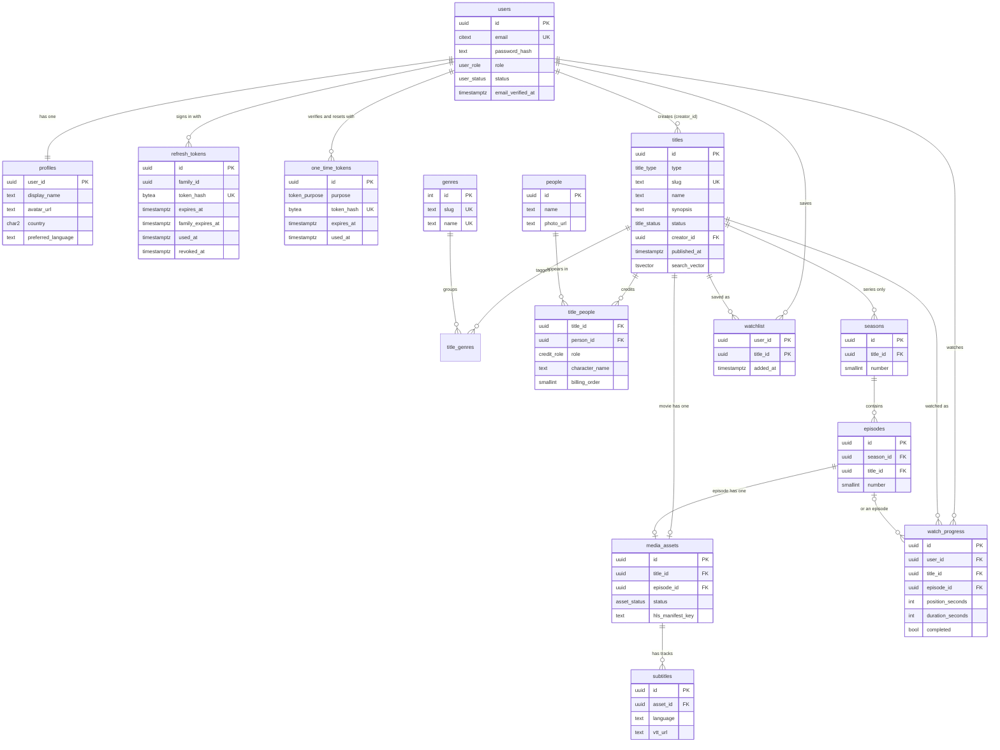

# Data model

PostgreSQL 16. Every change ships as a versioned migration with an up and a down file in `api/migrations/` (000001 to 000012). CI applies them up, rolls them all the way back and applies them again.

## Entity relationships

## Tables, one line each

| Table | What it is |
|---|---|
| `users` | An account: case-insensitive unique email, argon2id password hash, role (`viewer`, `creator`, `admin`), status (`active`, `suspended`), and when the email was verified. |
| `profiles` | The user's editable details: display name, avatar URL, country, preferred language. One row per user, created in the same transaction as the user. |
| `refresh_tokens` | Hashed rotating refresh tokens. Each row belongs to a family; using a token marks it used and issues the next one, and presenting a used token revokes the whole family. |
| `one_time_tokens` | Hashed single-use tokens for email verification and password reset, with an expiry and a used marker. |
| `genres` | Fixed reference list of ten genres (seeded by the migration, not sample data). |
| `people` | Cast and crew members: name and photo. |
| `titles` | A movie or a series: slug, name, synopsis, year, rating, language, artwork, owner (`creator_id`), status, `published_at`, and a generated full-text `search_vector`. |
| `title_genres` | Which genres a title belongs to. |
| `title_people` | Credits: who worked on a title as cast, director or writer, with character name and billing order. |
| `seasons` | Seasons of a series (the database refuses a season on a movie). |
| `episodes` | Episodes of a season; they repeat `title_id` so other tables can prove an episode belongs to a title. |
| `media_assets` | A playable HLS asset: exactly one per movie or per episode, with its processing status and manifest key. |
| `subtitles` | Subtitle tracks (language, label, WebVTT URL) of a media asset. |
| `watchlist` | A user's saved titles; one row per user and title. |
| `watch_progress` | Where a user stopped in a movie or an episode, whether they finished it, and when it last changed. |

## Deliberate choices

**ON DELETE.** `CASCADE` for data that has no meaning without its parent (profile, tokens, seasons, episodes, assets, subtitles, a user's watchlist and progress, a title's genre and credit links). `RESTRICT` where deleting should be a conscious act: a user who owns titles (`titles.creator_id`: suspend instead), a genre that titles use, a person who has credits. A self reference (`refresh_tokens.replaced_by`) is `SET NULL` so old tokens can be cleaned up.

**Integrity in the schema, not just the app.**
- `seasons` use a composite foreign key `(title_id, title_type)` to `titles (id, type)`, with `title_type` checked to be `series`. A season on a movie is rejected by Postgres, and a series cannot be turned into a movie while it has seasons.
- `watch_progress (episode_id, title_id)` references `episodes (id, title_id)`, so an episode can only be tracked under its own title.
- `media_assets` has a CHECK that exactly one of `title_id` and `episode_id` is set, plus unique indexes for one asset per playable. (That the title is a movie is enforced by the catalog code, not the table.)
- A published title must have a `published_at`. Slugs, ratings, language codes, country codes and URLs have CHECK constraints.
- Progress is unique per user and playable using two partial unique indexes (one for movies, one for episodes).

**Search.** `titles.search_vector` is a generated column: name weighted A, synopsis weighted B, through an immutable `app_unaccent` wrapper, so "omo alade" finds "Ọmọ Aládé". It uses the `simple` configuration because English stemming is wrong for Yoruba, Igbo and Hausa (ADR-0007).

## Indexes and proof they are used

Measured with `EXPLAIN (ANALYZE)` on 20,000 titles, 2,000 users, ~40,000 watchlist rows and ~20,000 progress rows (`make seed-bulk`, then `make explain`). With only a dozen rows Postgres correctly prefers a sequential scan, which is why the proof needs volume.

**Phase 1 Step 1 access patterns** (`api/seeds/explain_queries.sql`)

| Access pattern | Plan nodes (EXPLAIN ANALYZE, 20,000 titles) |
|---|---|
| 1. Browse: published titles, newest first (page 1) | Index Scan using `titles_status_published_idx` |
| 2a. By genre, COMMON genre (Drama): walks newest-first and probes membership | Index Scan using `titles_status_published_idx`; Index Only Scan using `title_genres_pkey` |
| 2b. By genre, RARE genre: starts from the genre index | Index Only Scan using `title_genres_genre_idx`; Index Scan using `titles_id_type_key` |
| 3. Watchlist for one user, newest first | Bitmap Index Scan on `watchlist_user_added_idx`; Index Scan using `titles_id_type_key` |
| 4. Continue watching: unfinished items, most recent first | Bitmap Index Scan on `watch_progress_continue_idx` |
| 5. Full-text search for one title (accent-insensitive, name weighted above synopsis) | Bitmap Index Scan on `titles_search_idx` |

**Catalog endpoints** (the query shapes `GET /v1/titles`, home, watchlist and continue-watching generate)

| Access pattern | Plan nodes (EXPLAIN ANALYZE, 20,000 titles) |
|---|---|
| A. newest published, page 1 (GET /v1/titles) | Index Only Scan using `titles_status_published_idx` |
| B. page 2 by keyset cursor (published_at, id) | Index Only Scan using `titles_status_published_idx` |
| C. language=yo | Index Only Scan using `titles_language_published_idx` |
| D. type=series | Index Only Scan using `titles_type_published_idx` |
| E. sort=name | Index Scan using `titles_name_idx` |
| F. trending: distinct recent viewers per title | Index Scan using `watch_progress_recent_idx` |
| G. genre filter (EXISTS) + newest | Index Only Scan using `titles_status_published_idx`; Index Only Scan using `title_genres_pkey`; Index Scan using `genres_pkey` |
| H. watchlist page and continue-watching (per user) | Index Scan using `users_email_key`; Bitmap Index Scan on `watchlist_user_added_idx`; Index Scan using `titles_id_type_key`; Bitmap Index Scan on `watch_progress_continue_idx` |

Notes:
- A search for a *very common* word (a term in about 1.5% of all rows) can choose a sequential scan on a table this small. That is the planner being right, not the index being unusable: forcing `SET enable_seqscan = off` shows the GIN index serving it, and selective searches use it unforced.
- Filtering by a common genre walks the newest-first index and probes genre membership (plan G); filtering by a rare genre starts from `title_genres_genre_idx`. If genre browsing becomes hot at much larger scale, denormalize a `genre_id` plus `published_at` index.
- The watchlist uses `watchlist_user_added_idx` and continue-watching uses the partial `watch_progress_continue_idx` (`WHERE NOT completed`), both per user.
- A dev sample set (12 fictional titles, marked `sample-` and `.invalid` URLs) loads with `make seed`; the bulk data for these plans with `make seed-bulk`. Both refuse to run unless `APP_ENV=local`.
